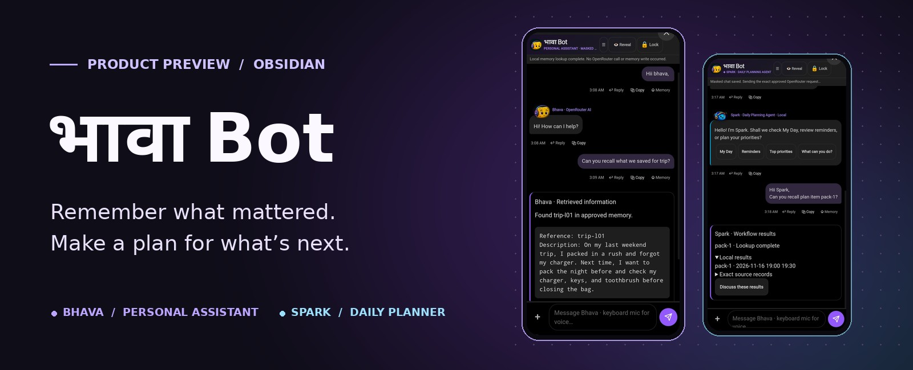
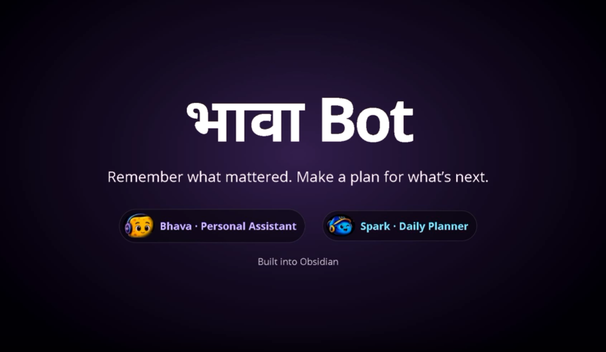
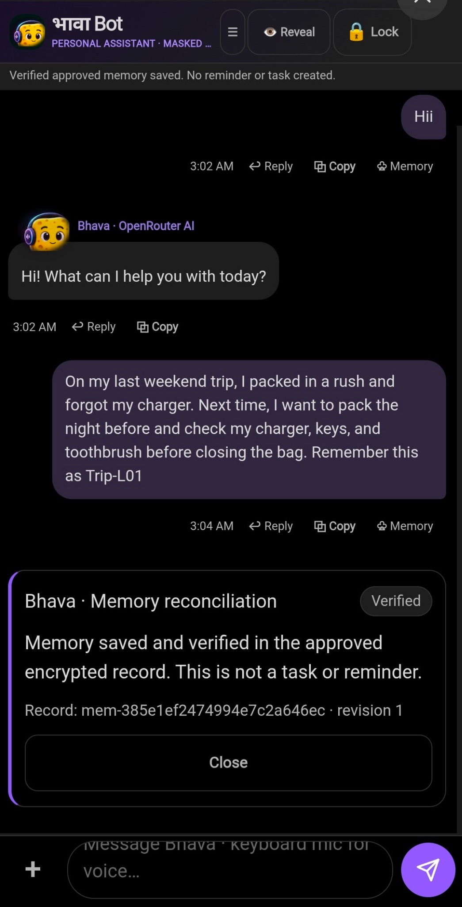
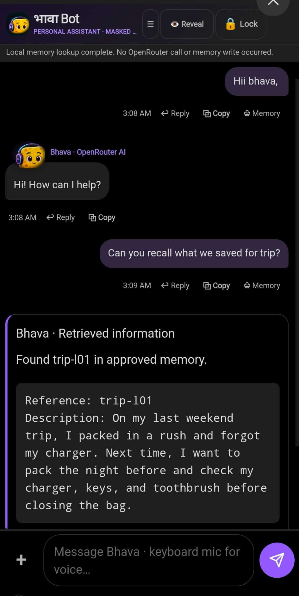
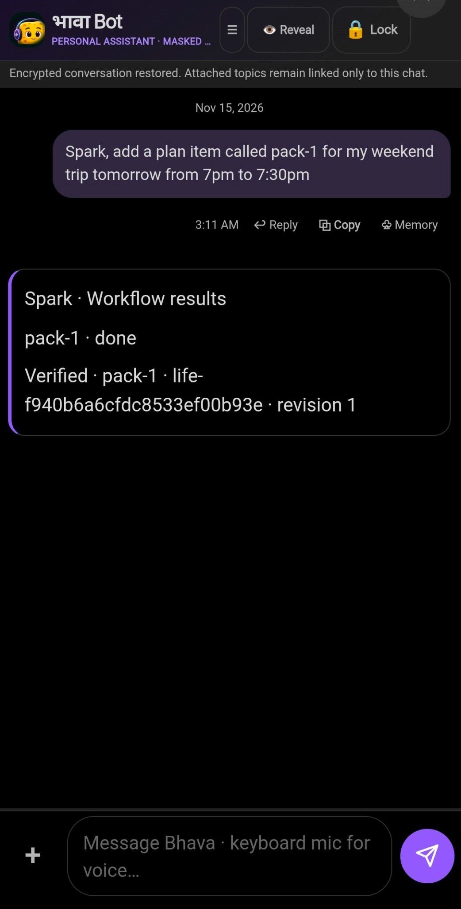
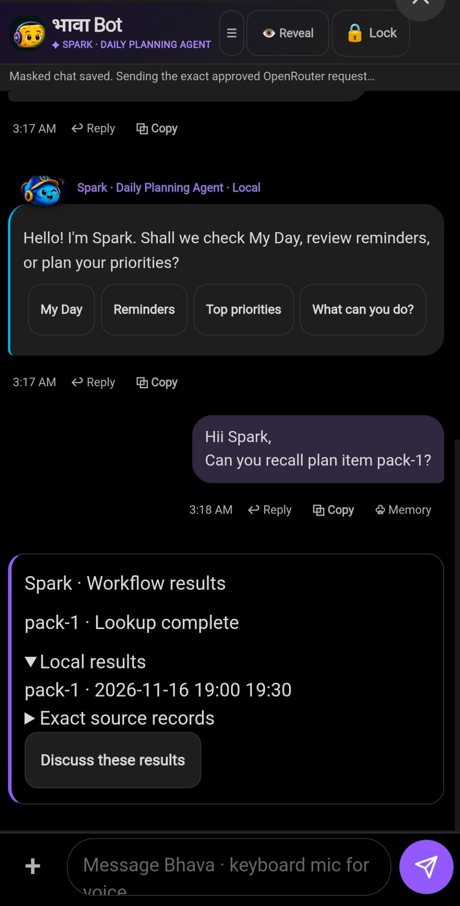

# भावा Bot

  

**Remember what mattered. Make a plan for what’s next.**

भावा Bot is a personal assistant inside Obsidian. **Bhava · Personal Assistant** helps you capture useful lessons, find what you approved for saving, and use it to think through a new decision. **Spark · Daily Planner** helps you choose priorities and turn a decision into a plan you can review.

## The Night Before

> “I’ll pack in the morning.”  
> “That’s what I said last time.”

Mira has a 6:40 AM train. Last time she packed in a rush, she reached for her charger and found an empty pocket. Bhava pulls up her saved packing lesson. With a 5:55 AM cab, when would she actually have to start packing?

Mira chooses to pack that evening. Spark proposes a 30-minute time block. Mira checks the time and approves it before it appears in her plan.

** Watch the भावा Bot product preview (https://youtu.be/sJqqR6PPmAU).** 

## Real app walkthrough

The screenshots come from the Obsidian test vault. Each step uses the same fictional weekend-trip example.

### 1. Save a lesson you’ll want to use again

After forgetting her charger, Mira writes down what she’ll do differently. Bhava prepares a memory change for review. The app verifies the saved entry after approval.

### 2. Bring the lesson back when it matters

Before another trip, Mira asks what she saved. Bhava finds the approved memory with the instruction to pack the night before and check the charger, keys and toothbrush. The saved note gives her something specific to compare with tomorrow’s early departure.

### 3. Turn the decision into time on the agenda

Mira asks Spark to block **7:00–7:30 PM** for packing. She checks and approves the proposed change. The screenshot shows the verified result after saving.

### 4. Check what actually landed

Mira asks Spark to recall the plan item `pack-1`. Spark returns it with the scheduled start and end times, so she can check the final plan against what she requested.

## Meet Bhava and Spark

| Agent | What it helps you do |
| --- | --- |
| **Bhava · Personal Assistant** | Capture useful information, decisions, lessons and goals with approval. Recall approved records and use them to compare options or identify a question worth checking. |
| **Spark · Daily Planner** | Review your morning briefing, prioritize tasks, build an agenda, work with reminders and reflect on the day. |

## What you review

A review card shows the proposed change before it’s saved to the vault. When a request uses OpenRouter, an outbound review lets you inspect the text and selected context, mask private details and approve the send. Supported local lookups can return directly in chat.

---

**भावा Bot** · **Bhava · Personal Assistant** · **Spark · Daily Planner**
